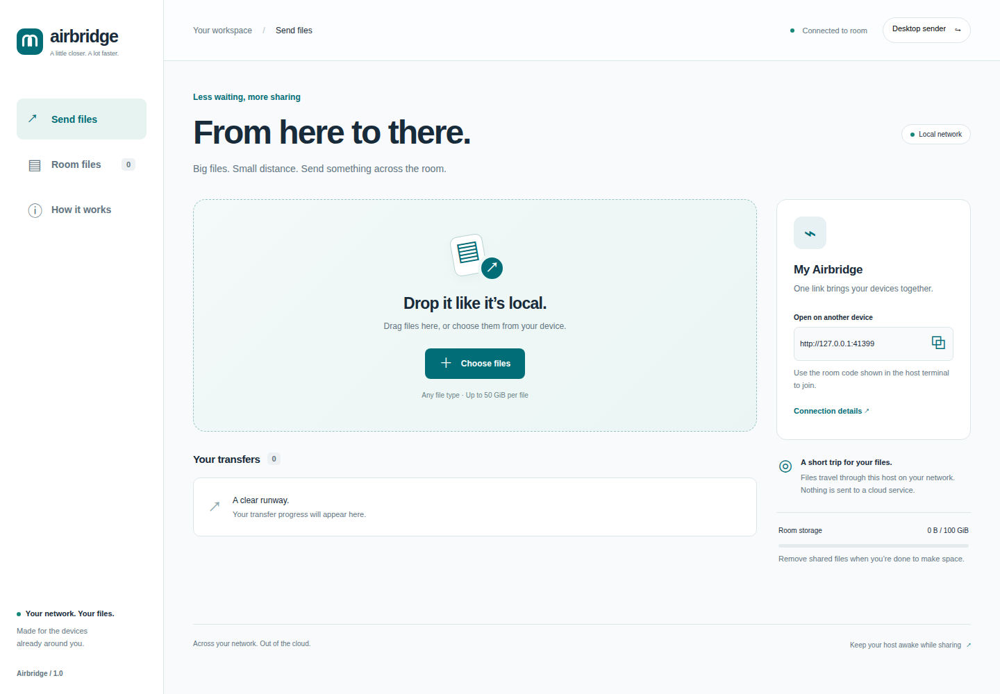

# Airbridge

**Big files. Small distance.** Share files between phones, tablets, and computers on the same local network, through a responsive browser UI.

One Mac or Linux computer hosts the room. Devices join using its local address and room code. Files stay on that host: no cloud service, account, external assets, or frontend build is required.



## Start sharing

### Before you start

- Choose a macOS or Linux computer to host the room. Keep it awake while sharing.
- Connect the host and receiving devices to the same trusted Wi-Fi or Ethernet network.
- Make sure the host has enough free disk space to store the uploaded files. The configured quota does not reserve physical disk space.
- Use a modern browser on each device. Phones, tablets, and receiving computers do not need to install Airbridge.

Choose one of the two startup options below. Use a release download to run Airbridge without development tools, or build from source to work on the project.

### Option 1: Run a release download

1. Download your host's `.tar.gz` archive and `SHA256SUMS` from [GitHub Releases](https://github.com/rushikeshg25/airbridge/releases/latest).

   Choose `macos-arm64` for Apple Silicon or `macos-amd64` for an Intel Mac. On Linux, choose `linux-amd64` for x86-64 or `linux-arm64` for ARM64. Run `uname -m` if you need to check the host architecture.

2. Open a terminal in the download directory. Set the archive name to the file you downloaded. Replace `X.Y.Z` and the platform in this example:

   ```sh
   cd ~/Downloads
   AIRBRIDGE_ARCHIVE="airbridge_X.Y.Z_macos-arm64.tar.gz"
   ```

3. Calculate the archive's checksum with the command for your host. Compare the result with the line for that exact filename in `SHA256SUMS`. Continue only if the hashes match.

   ```sh
   # macOS
   shasum -a 256 "$AIRBRIDGE_ARCHIVE"

   # Linux
   sha256sum "$AIRBRIDGE_ARCHIVE"
   ```

4. Extract the archive into a dedicated directory and start the host:

   ```sh
   mkdir -p airbridge
   tar -xzf "$AIRBRIDGE_ARCHIVE" -C airbridge
   cd airbridge
   ./airbridge
   ```

   macOS binaries are unsigned and not notarized. If macOS blocks the downloaded app, use the source build below.

### Option 2: Build and run from source

Install [Go 1.23 or later](https://go.dev/doc/install) and Git on the macOS or Linux host. Make is optional. Node.js and Python are not required to build or run the app.

1. Clone the repository and enter its directory. If you already have a checkout, open a terminal in that directory instead.

   ```sh
   git clone https://github.com/rushikeshg25/airbridge.git
   cd airbridge
   ```

2. Check that Go is available:

   ```sh
   go version
   ```

3. Build and start Airbridge:

   ```sh
   go build -o bin/airbridge ./cmd/airbridge
   ./bin/airbridge
   ```

   If Make is installed, `make run` builds and starts the same app in one step. There is no separate frontend server or dependency installation step.

### Join the room and transfer a file

1. Leave the host terminal open. Startup prints the room's addresses, code, and storage directory. For example, your output will look similar to this, with a different address and code:

   ```text
   Airbridge • My Airbridge
   Open http://192.168.1.13:8080
   Open http://localhost:8080
   Room code: 123456
   Files: ./data
   Keep this computer awake while transferring.
   ```

2. Open `http://localhost:8080` in the host's browser. On another device, open the printed local network (LAN) address, such as `http://192.168.1.13:8080`. Use the address from your terminal; `localhost` always refers to the device running the browser.
3. Enter a device name and the room code on each device, then select **Join the room**.
4. On the sending device, choose or drop a file in **Send files**. Keep that browser open until the upload finishes.
5. On the receiving device, open **Room files** and select **Download** for the completed file.

The host stores uploaded files in `./data` by default. Browser downloads go to the receiving device's download location. Android, iPhone/iPad, Windows, macOS, and Linux devices can join through a modern browser. Physical-device testing is still needed; see [verification](docs/verification.md).

### Stop and restart

Press **Ctrl+C** in the host terminal to stop Airbridge. Shutdown can take up to 15 seconds while active requests finish.

To restart, run `./airbridge` from the extracted release directory, or `./bin/airbridge` from the repository root. Use the same working directory and `-data` option to reopen the same files and incomplete uploads. Each restart ends existing sessions and generates a new room code unless you set `AIRBRIDGE_PIN`. Join again with the code shown in the terminal.

## What it includes

- Responsive desktop and phone UI, drag-and-drop, multiple file selection, and a searchable shared library.
- Live upload progress, approximate speed and remaining time, pause/resume, and bounded automatic retries.
- Resume after a browser reload or host restart: join again and select the **same original file in the same browser at the same host address**. Saved partial bytes are reused.
- 8 MiB chunks, two concurrent files per browser, and streamed disk writes. Files do not need to fit in RAM.
- Native browser downloads with HTTP byte ranges. Download resume depends on the receiving browser and a valid room session.
- Default 50 GiB per-file limit and 100 GiB room quota, both configurable.
- Durable file metadata, safe filenames, an exclusive host-directory lock, and room-code authentication.

Uploads go **sender → host disk**, then downloads go **host disk → receiver**. The full upload must finish before downloading. This design needs disk space on the host and is not direct device-to-device WebRTC.

## Host options

Run these examples from a source checkout after building. For a release download, replace `./bin/airbridge` with `./airbridge`. To change options on a running host, stop it first, then start it with the new command.

```sh
./bin/airbridge -listen :8080 -data ./data -name "Studio room"
./bin/airbridge -max-file 107374182400 -quota 536870912000
./bin/airbridge -listen 127.0.0.1:8080  # host browser only
```

| Option | Default | Purpose |
| --- | --- | --- |
| `-listen` | `:8080` | Bind address and port. The default listens on all interfaces. |
| `-data` | `./data` | Host storage directory, relative to the working directory. |
| `-name` | `My Airbridge` | Name shown in the UI. |
| `-max-file` | `53687091200` | Per-file limit in bytes: 50 GiB. |
| `-quota` | `107374182400` | Total reserved bytes: 100 GiB, including incomplete uploads. |

Both limits must be positive, and `-quota` must be at least `-max-file`. Run `./bin/airbridge -help` to list options, or `./bin/airbridge -version` to print build information.

A fresh room code is generated on startup. Set `AIRBRIDGE_PIN` in the host environment for a stable code (at least six characters). Do not put the code in URLs or source control. Sessions last 24 hours and end when the host restarts. Files and incomplete uploads remain until explicitly removed.

**Trusted LAN only:** the default HTTP transport is not encrypted. The code controls access; it does not protect traffic from network observers. Every joined member can download or remove every room file. Do not expose the port to the internet. Use a trusted network or a separately configured encrypted tunnel when necessary.

## Speed and recovery

Use wired Ethernet for the host where possible, or strong 5/6 GHz Wi-Fi. Both the host disk and the slowest network link affect throughput. Guest Wi-Fi isolation, VPN routes, or a firewall can prevent devices from reaching each other. Allow the selected port only on your trusted LAN; this app does not change firewall rules.

Pause before switching networks. Mobile operating systems can suspend background tabs. After an interruption, retry or select the same file again. The browser records the upload ID and checks the file’s name, size, modification time, and SHA-256 of its first/last 64 KiB samples. This guards against accidental reselection; it is **not a checksum of the entire file**. Changing the host address or clearing browser storage loses this resume mapping. Incomplete files remain visible for removal from Room files.

The quota reserves the whole declared size. Actual free disk space can be lower; disk errors stop the upload and appear in the UI. Remove unused files through Room files. Do not manually edit the host’s `.part`, `.blob`, or `.json` files. Back up the data directory while the host is stopped if you need to preserve the room.

## Troubleshooting startup and connections

- **`go: command not found`:** install Go, open a new terminal, and confirm that `go version` works. A release download does not need Go.
- **`make: command not found`:** use the `go build` and `./bin/airbridge` commands in the source instructions.
- **`address already in use`:** stop the process using port 8080, or start Airbridge with `./bin/airbridge -listen :8081`. Use the new port in every device's URL. For a release download, use `./airbridge -listen :8081`.
- **The data directory is already in use:** stop the other Airbridge host using that directory. To run a separate room, choose both a different port and a different `-data` directory. Do not delete the lock file.
- **Another device cannot open the page:** use the host's LAN address, including `http://` and the port. Confirm both devices are on the same network; a phone using mobile data cannot reach the private LAN address. Check guest Wi-Fi isolation, VPN routes, and the host firewall. A host started with `-listen 127.0.0.1:8080` only accepts connections from that computer.
- **The room code no longer works:** check the current host terminal. Restarting the host changes the code unless `AIRBRIDGE_PIN` is set, and all devices must join again.
- **Files appear to be missing after a restart:** check the printed `Files:` directory. The default `./data` path is relative to the directory where you started Airbridge. Restart from the original directory or pass its absolute path with `-data`.

## Development and verification

The runtime uses only Go’s standard library and native browser APIs. UI files are embedded in the binary; **rebuild and restart after editing them**.

Run development commands from the repository root. In addition to Go and Make, install Node.js 20+ for JavaScript checks and browser QA. Packaging and benchmarks require Python 3. Go race tests require a working C compiler and CGO support.

```sh
make check                         # race tests, go vet, JavaScript syntax
make build                         # current host binary
make package VERSION=1.0.0          # four platform archives + SHA256SUMS in bin/releases/
python3 scripts/benchmark.py --mib 1024  # disposable loopback test + SHA-256
```

Optional browser QA requires Node 20+ and Playwright:

```sh
npm install --no-save --package-lock=false playwright@1.62.1
npx playwright install chromium
make browser-test
# Or use system Chrome:
CHROME_PATH=/usr/bin/google-chrome make browser-test
```

The browser test starts its own host on a temporary port, uses a temporary data directory, checks independent sending/receiving sessions, and cleans up afterward. Screenshots go to `test-results/`. The benchmark also uses a disposable room. Neither test touches your normal `data/` directory.

See [architecture and protocol](docs/architecture.md) and [verification results](docs/verification.md).

## Publishing a release

Run `make check`, the browser smoke test, and `make package VERSION=X.Y.Z` from the release commit. Confirm `./bin/airbridge-linux-amd64 -version` on an x64 Linux build host and verify the archives with `sha256sum -c SHA256SUMS` from `bin/releases/`. Tag the verified commit `vX.Y.Z`, push that tag, and upload exactly the four matching archives and checksum file to its GitHub Release. Do not replace assets or move an existing release tag; use a new version for fixes.

CI runs Go race tests on Linux and macOS, plus the Chromium transfer tests and package checks on Linux. Build tools and browser test dependencies are not needed by release users.
