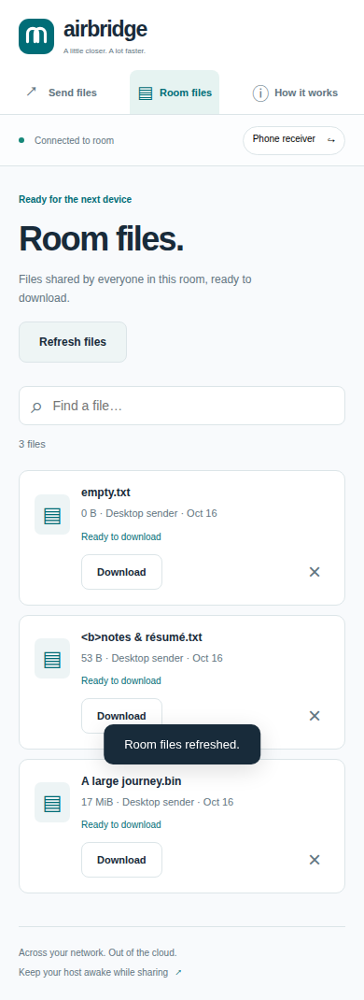

# Verification record

Verified on 2026-10-16 on Linux x86-64, with Go 1.27.1, Node 22.21.1, Playwright 1.62.1, and system Google Chrome. This records observed results, not promised network performance.

## Checks and outcomes

| Check | Result |
| --- | --- |
| `go test -race ./...` | Passed. Authentication, revocation, origin/host rejection, PIN rate limiting, upload validation, exact offsets, interrupted-write rollback, restart recovery, quota release, concurrent writers, zero-byte files, completion, downloads, HEAD, and ranges. |
| `go vet ./...` | Passed. |
| `node --check internal/web/assets/*.js` (each file) | Passed. |
| Python benchmark syntax | Passed using `ast.parse`. |
| `node scripts/browser-smoke.cjs` | Passed in isolated Chromium sessions. |
| Desktop/mobile layout | No horizontal overflow at 320, 390, 768, or 1440 px across Send files, Room files, and How it works. Screenshots inspected. |
| Browser runtime errors | None observed in the scripted workflow. |
| Browser transfer integrity | A 17 MiB + 137 byte file downloaded in a separate receiving session matched the original SHA-256. |
| Recovery | Paused after 8 MiB, restarted the host, rejoined, reselected the file, and completed the original upload ID without a duplicate. |
| File and UI edge cases | Zero-byte file, Unicode/HTML-like filename, search, removal, offline banner/recovery, and logout passed. |
| `make release` | Linux amd64/arm64 and macOS amd64/arm64 binaries built successfully. macOS binaries were not executed. |

The shutdown path was corrected to wait for graceful shutdown before exiting. The complete browser suite was rerun against the rebuilt binary and passed.

## 1 GiB local measurement

Command: `python3 scripts/benchmark.py --mib 1024`.

| Measurement | Observed |
| --- | ---: |
| Uploaded bytes | 1,073,741,824 |
| Upload including final disk sync | 2.283 s |
| Upload throughput | 448.6 MiB/s |
| Download including receiver SHA-256 | 0.761 s |
| Download throughput | 1,344.9 MiB/s |
| Full file SHA-256 match | Yes |

The test uses loopback HTTP and a temporary host directory. OS disk caching, CPU speed, and local storage affect these results. No physical Wi-Fi or Ethernet path was measured. The script deletes its test file and temporary directory afterward. It keeps only one 8 MiB transfer block at a time instead of allocating the whole 1 GiB.

## UI previews

Desktop sending workspace:

Phone-sized receiving library:

## Remaining verification

- Real Android, iPhone/iPad, and macOS browsers on a shared LAN have not been exercised. Browser viewport emulation is not a physical-device test.
- Safari/WebKit and Firefox have not been tested.
- Linux ARM and both macOS builds are cross-compilation results only.
- Physical LAN throughput, long-running mobile background behavior, and files above 1 GiB have not been measured.
- Power-loss durability, disk-full fault injection, and hostile-network penetration testing are not covered. Use this as a trusted-LAN tool, keep originals, and do not expose its default HTTP listener publicly.

## Local repository handoff

The initial implementation was delivered as 20 chronological local commits. The GitHub release follow-up adds review fixes and release tooling without rewriting that history. Build outputs and temporary test artifacts are ignored. The development decision log is retained locally under `logs/` and is intentionally not committed.

## Release review follow-up

Three defects were reproduced before fixing them: room-list blocking during a stalled chunk body, missed recovery in a data directory named `room[1]`, and a late fingerprint response enqueuing a selected batch after logout. Targeted regressions now cover each case. Browser work is scoped to its originating room and session generation, so stale requests cannot update a new room session. See the GitHub Actions run on the release commit for current hosted CI results.
